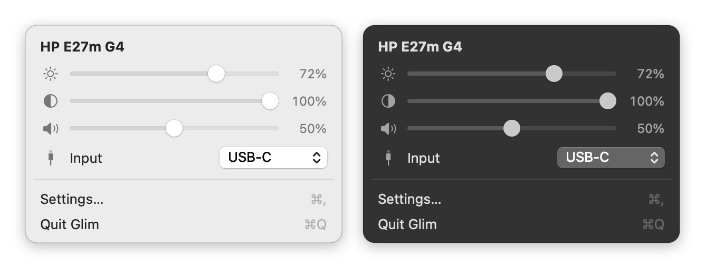

# Glim

Brightness, contrast, volume and input for your external display, from the Mac menu bar.



Glim is a native menu bar app for Macs with Apple silicon. It talks to the monitor itself, over DDC/CI and the monitor's own USB Audio device. Brightness is the real backlight, not a dimming overlay, and volume is the monitor's speakers even when they aren't the Mac's sound output.

## Supported monitors

| Monitor | Status |
| --- | --- |
| **HP E27m G4** | Tested. Every control below was exercised on the hardware, except input switching. |
| Other DDC/CI monitors | Untested. Glim offers the controls the monitor's own capabilities string lists, once each one answers a read, and marks the monitor as untested in the menu. |

| Control | How | HP E27m G4 |
| --- | --- | --- |
| Brightness | DDC/CI VCP 0x10 | ✅ verified |
| Contrast | DDC/CI VCP 0x12 | ✅ verified |
| Volume and mute | the monitor's USB Audio device (DDC 0x62 only mirrors it) | ✅ verified |
| Input (DisplayPort, HDMI, USB-C) | DDC/CI VCP 0x60, after a confirmation in the menu | ⚠️ implemented, not yet tried on the hardware |

## Requirements

- A Mac with Apple silicon, on macOS 14 (Sonoma) or later.
- A monitor connected over USB-C, DisplayPort or HDMI, with DDC/CI turned on in its own menu (it usually is by default).
- For the HP E27m G4's speakers, the USB-C connection: they are a USB device on the monitor's hub.

## Install

1. Download `Glim-x.y.z.dmg` from [Releases](https://github.com/malclement/Glim/releases).
2. Open it and drag **Glim** to **Applications**.
3. Open Glim from Applications. A sun appears in the menu bar. To start it with your Mac, turn on **Settings › General › Open Glim at login**.

A release that isn't notarized says so in its notes. macOS blocks such a build the first time it opens: choose **Open Anyway** in **System Settings › Privacy & Security**, or run `xattr -dr com.apple.quarantine /Applications/Glim.app`.

## Build from source

```sh
git clone https://github.com/malclement/Glim.git && cd Glim
make run     # builds dist/Glim.app and opens it
make test    # no monitor needed
```

The Xcode Command Line Tools are enough. [docs/development.md](docs/development.md) has the details.

## Known limitations

- **Input switching hasn't been tried on the hardware yet.** Switching to a port with nothing connected blanks the screen until you press the monitor's input button. That is why the menu asks first.
- Changes made with the monitor's own buttons show up the next time you open the menu; Glim doesn't poll.
- Glim uses a private macOS interface for DDC/CI, as MonitorControl, BetterDisplay and m1ddc do. A macOS update could break it; Glim then says DDC/CI is unavailable.
- Don't run another DDC/CI tool at the same time: their commands can collide on the bus.
- With two identical monitors, Glim can't tell which USB speakers belong to which, so it offers no volume control for either.
- Not for Intel Macs.

## Troubleshooting

| Problem | Try |
| --- | --- |
| The menu says **Not responding** | The monitor may be asleep or showing another input. Otherwise DDC/CI may be off in its menu (HP: **Management › DDC/CI**). Then choose **Try Again**. |
| No volume slider | Check that the monitor's USB is connected (USB-C on the HP). **Settings › Displays** shows which speakers Glim found. |
| A control is missing | Glim only shows controls the monitor answers for. **Settings › General** can also hide contrast, volume and input. |
| Something else | **Settings › Displays › Copy Diagnostics**, and attach the result to an [issue](https://github.com/malclement/Glim/issues). Serial numbers are left out. |

## How it works

[docs/architecture.md](docs/architecture.md) describes the design, and [docs/protocol.md](docs/protocol.md) the monitor protocol as Glim uses it. Glim began as a reverse-engineering study of the HP E27m G4, and that research is in the repository: [docs/controls.md](docs/controls.md) catalogs every DDC/CI control on the monitor, [docs/ddc-ci-protocol.md](docs/ddc-ci-protocol.md) covers the wire protocol on Apple silicon, [docs/macos-usb-webcam.md](docs/macos-usb-webcam.md) covers the rest of the hardware, and [tools/](tools) holds the CLI and probes used to find it all out.

## Contributing

Bug reports, tests on other monitors and pull requests are welcome; see [CONTRIBUTING.md](CONTRIBUTING.md).

## License

[MIT](LICENSE)
